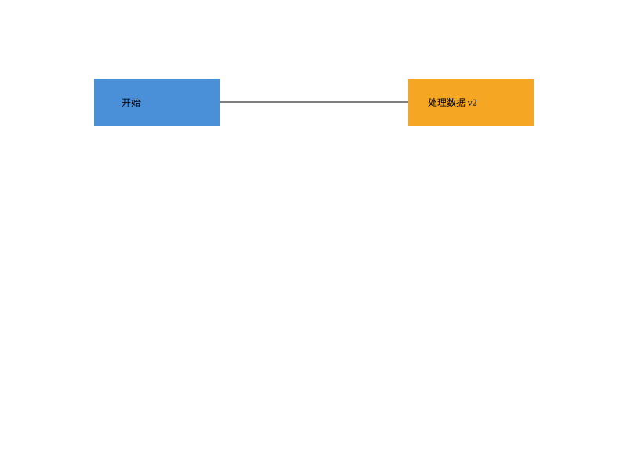
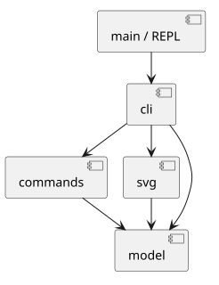

# SVG Editor

基于 **TypeScript** 的命令行 SVG 编辑器。通过一组简洁的文本命令创建、组织和修改矢量图形，支持图形分组、撤销与重做，以及 SVG 文件的读取和保存。

项目以 **Composite（组合模式）** 和 **Command（命令模式）** 为核心，关注图形对象建模、编辑操作的可撤销性，以及交互层与领域模型的分离。

[快速开始](#快速开始) · [命令参考](#命令参考) · [项目架构](#项目架构) · [设计文档](doc/README.md)

## 效果预览



上图对应仓库中的 [`examples/flowchart.svg`](examples/flowchart.svg)。它由命令行创建，包括分组、矩形、文本与连线；生成过程可查看 [`examples/flowchart.txt`](examples/flowchart.txt)。

## 功能特性

- **六种基础图形**：矩形（`rect`）、圆形（`circle`）、椭圆（`ellipse`）、直线（`line`）、文本（`text`）和分组容器（`g`）。
- **图形编辑**：创建、删除、平移、等比缩放和修改属性，使用唯一 `id` 定位对象。
- **层级管理**：在指定容器内创建图形，对已有图形分组、调整所属容器，以及修改同级绘制顺序。
- **撤销与重做**：以一条编辑命令为一个历史单元；失败的编辑不会破坏当前文档。
- **SVG 文件读写**：读取已有 SVG、保存标准 SVG 文件，并为导入文件中缺少 `id` 的元素自动生成标识。
- **结构化查看**：通过 `tree` 查看图形层级，通过 `show` 检查元素属性，无需依赖图形界面。

> 当前版本是 **CLI 编辑器**，不是可视化拖拽工具。它实现了项目范围内的六种 SVG 元素，不以完整覆盖 SVG 标准为目标。

## 快速开始

### 环境要求

- Node.js **22 或更新版本**
- npm

### 安装与启动

```bash
git clone https://github.com/starpickerr/svg-editor.git
cd svg-editor
npm ci
npm run cli
```

启动后进入交互式命令行：

```text
svg> init 400 200
canvas 400x200 created
svg>
```

使用 `help` 查看支持的命令。每次启动会话后，先通过 `init` 创建画布，或通过 `read` 打开 SVG 文件。使用 `Ctrl+D` 退出。

### 五分钟示例：创建一张简单流程图

依次在交互式命令行中输入：

```text
init 400 200
create g flow
create rect start 30 70 120 60 #4a90d9 in flow
create text start-label 55 105 "Start" in flow
create rect end 250 70 120 60 #f5a623 in flow
create line edge 150 100 250 100 black in flow
tree
save demo.svg
```

上述命令创建一个名为 `flow` 的容器，并在其中放置两个矩形、一个文本标签及一条连线。`tree` 输出层级结构，`save` 将结果写入 `demo.svg`。

生成的 `.svg` 文件可以直接用浏览器打开，或在支持 SVG 预览的编辑器中查看。

### 回放完整示例

仓库提供了可重复执行的流程图脚本：

```bash
npm run cli < examples/flowchart.txt
```

该脚本会保存至 `examples/flowchart.svg`，**因此会覆盖此路径下原有的示例文件**。如需修改并保存自己的内容，建议使用单独的输出文件名。

## 命令参考

### 文档与文件

| 命令 | 用途 |
| --- | --- |
| `init [w] [h]` | 新建画布；默认大小为 800 × 600 |
| `read <file.svg>` | 读取 SVG 文件 |
| `save [file.svg]` | 保存 SVG；省略路径时使用上一次成功读取的文件路径 |
| `canvas [w] [h]` | 查看或修改画布大小 |

使用 `init` 创建的新文档在第一次保存时需要指定文件路径，例如 `save demo.svg`。

### 创建与编辑

| 命令 | 用途 |
| --- | --- |
| `create <type> <id> ... [in <containerId>]` | 创建图形，可直接放入指定容器 |
| `delete <id>` | 删除图形；删除容器时一并删除子元素 |
| `move <id> <dx> <dy>` | 按增量平移图形 |
| `scale <id> <factor>` | 按比例缩放图形 |
| `set <id> <attr> <value>` | 修改受支持的几何属性或样式属性 |
| `group <newGid> <id1> <id2> ...` | 将至少两个已有图形组成容器 |
| `ungroup <gid>` | 解散非顶层容器 |
| `addto <gid> <id>` | 将已有图形移入指定容器 |
| `front <id>` / `back <id>` | 调整同一层级的绘制顺序 |

创建命令示例：

```text
create rect r1 10 20 100 60 #4a90d9
create circle c1 180 80 30 red
create ellipse e1 250 80 50 25
create line l1 10 150 300 150 black
create text t1 20 180 "Hello SVG"
create g layer1
create rect r2 10 10 80 40 blue in layer1
```

其中颜色参数可省略；文本内容包含空格时应使用双引号。可通过 `help` 查看各图形类型的完整参数语法。

### 查看与历史

| 命令 | 用途 |
| --- | --- |
| `tree [id]` | 显示文档结构树，或指定元素的子树 |
| `show <id>` | 显示图形属性和父容器 |
| `help` | 显示命令语法 |
| `undo` | 撤销最近一次成功的编辑 |
| `redo` | 重做已撤销的编辑 |

**操作约定：** 图形 `id` 唯一且区分大小写；坐标原点位于左上角，x 轴向右、y 轴向下；整行以 `#` 开头的内容会作为注释忽略。失败的命令统一以 `error:` 输出错误，不会修改文档。

**历史边界：** `init`、`read`、`save` 和修改画布尺寸的 `canvas` 操作会建立新的历史边界；下一次成功编辑之前不能撤销或重做之前的操作。

## 项目架构

```text
src/
├── main.ts        # 交互式命令行入口
├── cli/           # 命令解析、路由、输出与会话管理
├── commands/      # 编辑命令、执行器、撤销与重做
├── model/         # 图形对象、容器树与文档模型
└── svg/           # SVG 解析、序列化和文件读写
examples/          # 示例 SVG 与命令脚本
test/              # 自动化测试
doc/               # 架构设计与项目过程文档
```



### 核心设计

**Composite（组合模式）**：`Shape` 抽象类定义统一的图形操作接口，`Group` 负责维护子图形。编辑器可以用一致的方式处理单个图形和图形组，容器的移动与缩放会作用于其子元素。

**Command（命令模式）**：每次编辑由独立命令对象描述，`Editor` 管理执行、撤销和重做。当前实现使用内存中的文档快照恢复编辑状态，使涉及多个元素的操作也能作为单个历史单元处理。

**职责隔离**：`model` 不依赖命令行或文件系统；`commands` 依赖领域模型；`svg` 负责文件格式转换；`cli` 组合上述能力并提供用户交互入口。

完整的模块依赖规则、设计取舍、开发过程、自查与测试记录请阅读 [`doc/README.md`](doc/README.md)。

## 开发与测试

```bash
# TypeScript 类型检查
npm run check

# 自动化测试
npm test

# 编译 TypeScript
npm run build

# 运行编译后的程序
node dist/src/main.js
```

测试覆盖图形建模、层级编辑、撤销重做、SVG 读写和 CLI 行为。可在 [`test/`](test/) 目录查看测试用例。

## 当前范围与后续扩展

当前编辑器主要支持基础 SVG 元素及其结构化操作。读取外部 SVG 时，不支持的元素或无效内容可能导致读取失败；已有 SVG 的部分扩展属性能够被保留，但不保证任意复杂 SVG 特性的完整编辑语义。

图形类型注册、复合图形（例如带标题的 `box`）以及可视化交互界面是可探索的后续方向，**尚未作为现有功能提供**。

---

本项目使用 TypeScript、Node.js 与 [`@xmldom/xmldom`](https://github.com/xmldom/xmldom) 实现。项目源码、示例和设计文档均可在本仓库查看。
