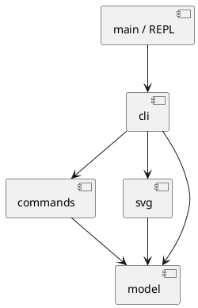

# Lab1 Phase 1：SVG 编辑器（CLI）

Node.js 22 或更新版本；在工程根目录执行：

```bash
npm ci
npm run cli
```

先输入 `init` 或 `read examples/other.svg`，再输入 `help` 查看所有命令与各类型参数。双引号包裹空格参数，支持引号内的 `\"`、`\\`；整行以 `#` 开头表示注释，颜色中的 `#` 不会被截断。用 Ctrl-D 结束 REPL。

可执行 `npm run cli < examples/flowchart.txt` 回放流程图案例，然后在浏览器打开 [生成的 SVG](../examples/flowchart.svg)。`npm run build` 后也可直接运行 `node dist/src/main.js`。

## 架构方案

### 模块与依赖方向

| 目录 | 职责 | 允许依赖 |
| --- | --- | --- |
| `src/model/` | 图形封装、多态几何操作、Composite 树与文档不变量 | 本模块 |
| `src/commands/` | 编辑 Command、撤销重做、编辑事务 | model |
| `src/svg/` | SVG 解析、序列化、文件读写 | model、XML 库与 Node 文件 API |
| `src/cli/` | 分词、参数校验、命令分发、文本输出、会话协调 | commands、model、svg |
| `src/main.ts` | REPL 与标准输入输出接线 | cli、Node readline |
| `test/` | 验证可观察行为与关键不变量 | 以上生产模块、Node 测试 API |



领域模型不依赖 CLI、历史或文件系统，保证同一行为可用于测试和其他交互入口。Command 只处理编辑与历史，SVG 模块不负责改变会话历史；CLI 在成功的文档操作后建立历史屏障。反向依赖或循环依赖均为待处理项。

### 设计模式的选择

- **Composite**：抽象 Shape 定义统一操作，六个具体图形中 Group 管理有序子节点。叶子与容器通过多态完成移动、缩放、属性修改和复制，不在外部按标签分派行为。
- **Command**：每条编辑请求封装为命令对象；历史管理器负责执行、撤销和重做。一条编辑命令构成一个历史单元。采用内存快照保证复杂树操作的失败原子性与完整恢复，不把 SVG 文件当作历史存储。
- **集中工厂与命令分发**：类型名到图形构造、命令名到实现各集中于一个位置。这是任务允许的两处名字分派，**均标注为待重构点**；本阶段不提前实现注册插件。

### 变化点假设

1. **增加图形类型**：扩展 Shape 子类与集中工厂；保留多态边界，不实现后续 `box` 插件。
2. **增加交互入口**：模型与 Command 不依赖终端，未来可复用；当前不实现 GUI 或其他交互协议。
3. **增加 SVG 能力**：解析与序列化封装在 svg 模块；本阶段面向任务的六种元素，不追求完整 SVG 标准。
4. **大文档历史性能**：快照成本随文档规模增长，当前以正确恢复为先；有真实性能证据后再考虑命令增量逆操作。

### 行为决策

- 已确认的分组规则：同父级 group 在最早被选节点的位置建组；跨父级 group 在最近公共祖先下建组；组内按原树先序排列，与参数顺序无关。
- 以任务 §4.2 的明确错误约定为准，禁止解散根级容器；不将 §3 的通用 ungroup 描述理解为豁免。
- `front` 移到 SVG 同级最后绘制的位置（视觉最前）；`back` 移到最先绘制的位置。分组保留未选中节点及空原父容器。
- 成功文档操作建立新历史基线，清空旧 undo/redo 并禁用二者；下一次成功编辑解除屏障。失败操作既不更新文档，也不清除 redo 或屏障。
- SVG 导入先预留全部显式 id，再为缺 id 元素分配名称，避免与文件后部的显式 id 冲突。警告只有整次读取成功后才输出。
- SVG 读取支持六种元素，保留额外属性（如 transform、font-size）并在保存时写回；编辑几何值采用元素局部坐标，不实现任意 SVG 变换矩阵的归一化。未支持的元素或无效 XML 会令整次读取失败，不能静默丢弃。
- `init` 的缺省尺寸为 800×600；`canvas` 无参数只查询，只给宽度则保留当前高度。按任务的未初始化错误约定，`help` 也须先有文档。
- 无参数 `save` 使用最近一次成功 `read` 的路径；显式保存到其他文件不改变该读入路径，`init` 会清除路径。
- 其他未明确细节将在实现中记录，涉及实质歧义时先确认，不修改任务原文。

## 过程记录

- 起始仓库只有本地规范及未跟踪的 `.gitignore`，没有实现、提交或远程。重新阅读实际规范后发现分支策略已更新，因此使用 `develop`，核心机制按指定任务分支开发，保留真实演进。
- 在设计审查中识别出跨父级 group 的落点和顺序未定义；提出最近公共祖先与原树先序的方案，经确认后记录于上。
- 远程仓库使用 `https://github.com/starpickerr/fudan_softdesign.git`；具体截止时间尚未提供。发布到 main 和最终标签不属于自动执行范围。
- 历史设计审查发现：只在命令结束后保存历史，仍可能让容器操作中途失败时遗留部分变更。因此编辑先作用于文档副本，成功后才发布；通过第二个子元素数值溢出的场景验证整条命令的状态不变。
- 文件读写审查补充了两项失败场景：读取先遇到缺 id、后遇到非法几何值时不输出半次成功的警告，也不替换当前文档；覆盖只读文件失败时保留原内容。保存后的临时目录清理采用尽力清理，避免成功替换文件后仅因清理失败而错误地报告保存失败。

## 一致性自查

当前为实现前方案。实现完成后依据实际目录和引用更新此节，不预先宣称通过。

## 质量保证手段

计划使用 TypeScript 严格检查、Node 测试、CLI 脚本回放与 SVG 实际预览。实际结果与覆盖范围将在执行后记录，计划不等同于通过。
